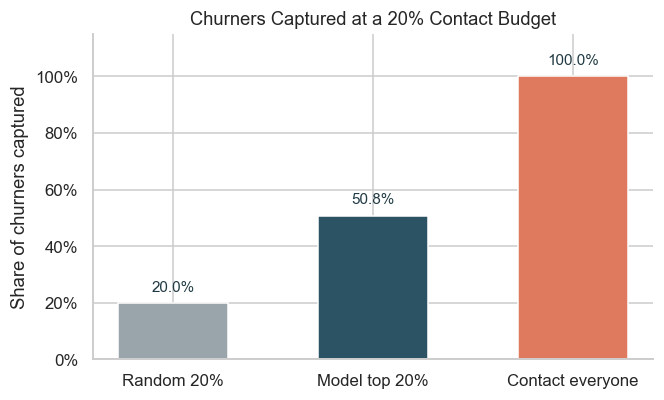

<p align="center">
  
</p>

[](https://www.python.org/)
[](https://scikit-learn.org/)
[](https://xgboost.readthedocs.io/)
[](https://optuna.org/)
[](https://shap.readthedocs.io/)

The useful output is not a leaderboard score. It is a **ranked call list** that, on **1,409** held-out IBM Telco customers, puts **190 of 374** actual leavers into **282** contacts: **50.8% capture** at **67.4% precision** — **2.5×** a random 20% list at the same headcount.

| Decision | Number | What it is |
|----------|--------|------------|
| Ranked list (top 20%) | **282** people · **190** true leavers | Who to call this month |
| High / Low flag at 0.59 | **491** people · **$441,250** | 12-month billing *behind* the flag — exposure, not a loss forecast |
| Costed campaign on the 282 | **$14,100** cost · **$37,043** net · **3.6×** | $50 per contact and a **35%** save rate; break-even ≈ **10%** |

The 50.8% capture is measured on the holdout. The 3.6× is not: replace the $50 contact cost and 35% save rate with a pilot before it goes in a budget.

---

## Why accuracy is the wrong score

IBM Telco Customer Churn: **7,043** subscribers, **21** raw fields, **26.5%** leavers ([IBM public sample](https://www.kaggle.com/datasets/blastchar/telco-customer-churn); local copy in `data/raw/`).

A model that predicts “stay” for everyone is already **73.5%** accurate and catches **zero** at-risk accounts. This project optimizes **PR-AUC**, then recall and top-20% capture — the metrics a retention desk can staff to.

**Business objective.** Rank the current base by churn risk, explain *why* each account is High in terms a team can act on, and translate that ranking into a costed campaign on the same rows the model never saw during training.

---

## Approach

CRISP-DM, with three non-negotiables:

1. **Leakage screen first.** Identifier-like columns and suspiciously strong target association are checked before any model is fit. `ChargeRatio` looks unique (96.4%) — a false positive (Pearson *r* ≈ 0.026).
2. **One shared pipeline.** `StandardScaler` + one-hot in a single `ColumnTransformer`, fit only on train. Logistic regression, random forest, and XGBoost see the same features.
3. **Weights, not SMOTE.** `scale_pos_weight` ≈ 2.77. Train on the real 2.8:1 mix so later calibration is not built on synthetic rows.

**Split.** 80/20 stratified (`random_state=42`): **5,634** train / **1,409** test. Both stay at 26.5% churn.

**Engineered fields.** `ChargeRatio` (monthly bill / accumulated history), `TenureBucket`, `TotalServicesSubscribed`.

---

## What the data already shows (training set)

| Pattern | Number | Reading |
|---------|--------|---------|
| Median tenure | **10** mo leavers vs **38** mo stayers | **55%** of leavers are gone by month 12 |
| Contract churn | **42.7%** / **11.1%** / **2.9%** | Month-to-month is 55% of the base and **89%** of leavers |
| Median bill | **$80** vs **$64** | +$16/mo, but the boxes overlap; fiber sits inside the gap |
| `ChargeRatio` × `MonthlyCharges` | *r* = **−0.04** | Bill *versus history* is a different axis from the raw dollar amount |

Association, not a conversion experiment. The 2.9% two-year rate describes people who already chose a term.

---

## Champion model (held-out test)

| Model | Test PR-AUC | Notes |
|-------|------------:|-------|
| Logistic regression | 0.635 | First before tuning |
| Random forest | 0.621 | Highest precision at the default 0.5 cut |
| XGBoost, untuned | 0.602 | Why defaults do not ship |
| **XGBoost, Optuna-tuned** | **0.658** | **+0.022** vs logistic · ROC-AUC **0.850** |

Optuna (30 trials, 4-fold on train) picked a shallow regularized tree (`max_depth=4`, 450 estimators). CV peak **0.674**; **0.658** is the holdout number that counts.

### Threshold 0.59 is the flag — not the call list

F1-max cutoff **0.59** (default 0.50). Precision **56.2%**, recall **73.8%**, F1 **0.638**. Confusion: **276 / 215 / 98 / 820**. That marks **491** accounts High and sizes the **$441,250** exposure. Staff **282** from the *ranking*.

F1 treats a wasted contact and a missed leaver as equal. Under the campaign assumptions they are not ($50 vs a year of bill). 0.59 is a conservative proxy, not a cost-optimal budget.

### Do not say “0.59 means 59%”

| Check | Number |
|-------|--------|
| Brier | **0.162** (no-skill always-26.5% is 0.195) |
| Mean predicted vs observed | **40.8%** vs **26.5%** |
| Worst-bin gap | **28.6 pp** (pred 58% · obs 30% — sits on the flag) |

`scale_pos_weight` shifted the scoreboard up. Ranking and flag-then-sum-bills still hold: neither multiplies by *p*. What-if *levels* (95.1% → 69.3%) sit on that inflated scale; direction is usable.

---

## Why each customer is High (SHAP)

TreeSHAP on the fitted classifier after the preprocessor. Additivity holds to **2.86e-06** across all 1,409 rows — an exact decomposition of *this* model, including the over-call. Not a causal treatment effect.

<p align="center">
  
</p>
<p align="center"><em>Figure 1. Global SHAP importance on the 1,409-row holdout. Mean |SHAP| is the average size of each feature’s push on the raw margin, not a correlation and not a probability. Orange = top four; gray = the long tail. Source: notebooks/01_churn_analysis.ipynb §4.5.</em></p>

| Lever | Mean abs. SHAP | Share of top-15 mass |
|-------|---------------:|---------------------:|
| Month-to-month dummy | 0.565 | **21%** |
| `ChargeRatio` | 0.328 | **12%** |
| Fiber optic | 0.278 | **10%** |
| Two-year dummy | 0.210 | **8%** |
| All contract dummies | | **29%** |
| Those four (orange) | | **51%** |

**Reading.** Contract is the first *family* (it appears twice), then bill-versus-history, then fiber. Engineered `ChargeRatio` outranks raw `MonthlyCharges` (**7%**). Electronic check ties the raw bill. `TotalCharges` sits at the bottom (**3%**): once tenure and the monthly rate are in, the lifetime sum is not doing independent work. Gender and senior-citizen status are not in this top 15.

Do not read the bars as “switch everyone to two-year and churn falls 29%.” Sign is in the beeswarm; this chart only answers *how much*. Already-on-term customers are largely protected by the term; “offer a contract” only fits month-to-month.

**Worst holdout row** (1-month fiber, $95.10, no support): predicted **95.1% → 81.5%** (one-year contract) → **69.3%** (+ Tech Support and Online Security). Still High vs 0.59. Contract is necessary. It is not sufficient for that row.

---

## Holdout ranking and the 20% call list

<p align="center">
  
</p>
<p align="center"><em>Figure 2. Risk deciles on the same 1,409 holdout customers (decile 1 = highest predicted risk). Orange bars: observed churn rate. Navy line: cumulative share of the 374 leavers. Dashed line: 26.5% base rate. Source: notebooks/01_churn_analysis.ipynb §5.1.</em></p>

**Reading.** The staircase is monotonic: **75.9%** churn in decile 1 (107 of 141; **2.86×** base) down to **0.7%** in deciles 9–10. That is ranking quality, not calibration — Section 4.4 already showed the scores over-call. The capture line is the capacity argument: the top two deciles (**20%** of customers) hold **50.8%** of leavers (190 of 374). A random 20% list would capture about 20%. The remaining 184 leavers sit further down; reaching them means buying more call capacity, not a different model.

<p align="center">
  
</p>
<p align="center"><em>Figure 3. Same 20% budget, three policies. Gray is the honest baseline. Navy is the ranked list this project ships (282 names, 190 true leavers, 67.4% precision). Orange is 100% capture at 5× the effort. Source: notebooks/01_churn_analysis.ipynb §5.2.</em></p>

**Reading.** A 20% budget is **282** people out of 1,409. The model puts **190 of 374** leavers on that list: **50.8% capture** at **67.4% precision**. That is **2.5×** random at the same headcount. This is the list Section 5.4 prices ($14,100 · $37,043 net · 3.6× under a 35% save-rate *assumption*). The 491-person flag at 0.59 is a different job — exposure, not this call list.

| Job | Use | Do not use |
|-----|-----|------------|
| Who to call this month | Top 20% list · 282 · 190 leavers (Fig. 3) | The 491-person flag |
| Who is High / Low | Threshold 0.59 · 491 accounts | “0.59 means 59%” |
| How much billing sits at risk | $441,250 behind the flag | *p* × bill × 12 |
| What a campaign might return | 3.6× on $14,100 · 35% save | A budget number until the save rate is measured |

---

## Repository

```
customer-churn-prediction/
├── data/raw/                      IBM Telco CSV (included)
├── notebooks/01_churn_analysis.ipynb
├── src/
│   ├── data_processing.py         Cleaning + ChargeRatio / TenureBucket / services
│   ├── data_pipeline.py           Split + shared ColumnTransformer
│   ├── modeling.py                Bake-off, Optuna, threshold, calibration
│   ├── interpretability.py        TreeSHAP, additivity check, cohort SHAP
│   └── business_impact.py         Deciles, targeting, exposure, ROI, what-if
├── app/                           Reserved for champion_pipeline UI
├── assets/
│   ├── readme-header.svg          Cover banner
│   └── figures/                   Notebook plots used in this README
├── reports/                       Briefing decks (see below)
└── requirements.txt
```

The notebook is the narrative. `src/` is what a later `app/` import should call — no transformation logic lives only in a cell.

---

## Reproduce

```bash
python -m venv venv
source venv/bin/activate          # Windows: venv\Scripts\activate
pip install -r requirements.txt
jupyter lab notebooks/01_churn_analysis.ipynb
```

Run all cells in order. No download step: the CSV is already in `data/raw/`. All holdout numbers above use `random_state=42`.

**Presentations.** `reports/Customer_Churn_Prediction.pptx` is the briefing deck. Rebuild scripts (same locked numbers): `python reports/build_brief_presentation.py` or `python reports/build_presentation.py`.

---

## What this is not

- Not a causal claim. SHAP and the what-if cell move *the model*.
- Not a loss forecast. $441,250 assumes the current bill continues for a year and treats every flagged account as a leaver.
- Not a multi-split result. One 80/20 cut. One snapshot: who is at risk *now*.

**Do this next, in order.** (1) Pilot the 282 so 35% becomes a measured save rate. (2) Staff the list, not the flag. (3) Promote `champion_pipeline` into `app/` with the notebook’s live controls.

---

## Citation

IBM. *Telco Customer Churn.* Public sample dataset, 7,043 customers / 21 features.

Chapman et al. (2000). CRISP-DM 1.0. · Chen & Guestrin (2016). XGBoost. · Akiba et al. (2019). Optuna. · Lundberg & Lee (2017). SHAP. · Niculescu-Mizil & Caruana (2005). Calibration.

---

## Author

**Sileshi Hirpa** · Data Science · Business Analytics · Arizona State University

[hirpast@gmail.com](mailto:hirpast@gmail.com) · [linkedin.com/in/sileshi-hirpa](https://www.linkedin.com/in/sileshi-hirpa) · [github.com/sileshith](https://github.com/sileshith) · [hirpadata.com](https://hirpadata.com/)
