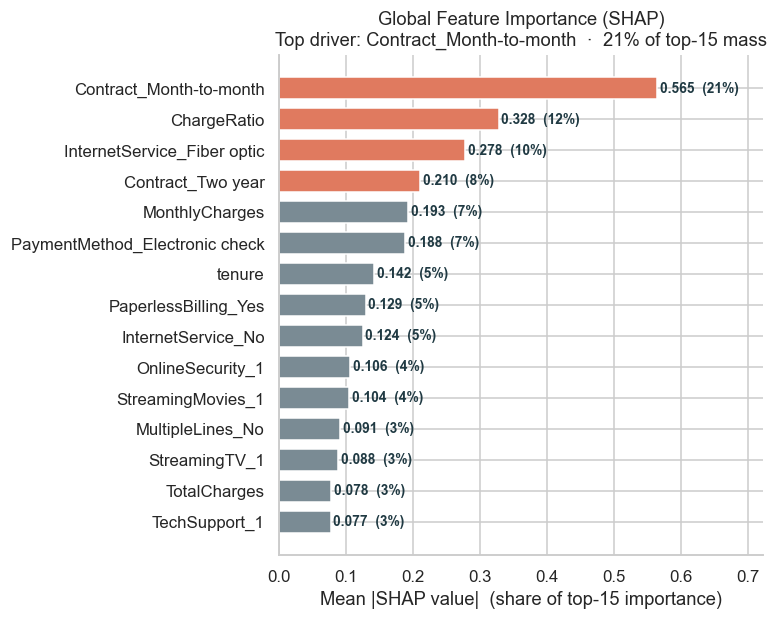
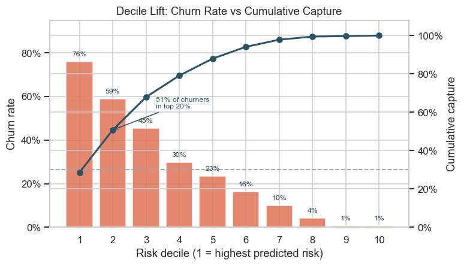

<p align="center">
  
</p>

<p align="center">
  
  
  
  
  
</p>

## Executive summary

A ranked retention list, not a leaderboard score. All figures are one 80/20 holdout (random_state=42): **1,409** customers, **374** leavers, **26.5%** base rate.

- **Call list (top 20%):** 282 contacts capture **190 of 374** leavers (50.8% capture, 67.4% precision, 2.5x a random 20% list).
- **High / Low flag (0.59):** 491 accounts; **$441,250** of 12-month billing sits behind the flag. Exposure, not a loss forecast.
- **Campaign scenario on the 282:** $14,100 cost, $37,043 net, **3.6x**. Assumes $50 per contact and a 35% save rate. Break-even is about 10%. The 50.8% capture is measured. The 3.6x is not.

## Project and objective

**Data.** IBM Telco Customer Churn: 7,043 subscribers, 21 raw fields, 26.5% leavers ([public sample](https://www.kaggle.com/datasets/blastchar/telco-customer-churn); local copy in [`data/raw/`](data/raw/)).

A model that predicts "stay" for everyone is already 73.5% accurate and catches zero at-risk accounts. This project optimizes PR-AUC, then recall and top-20% capture.

**Objective.** Rank the current customer base by churn risk, attribute each High score to features a retention team can act on, and convert that ranking into a costed campaign on holdout rows the model never saw during training.

**Core hypotheses**

- Month-to-month contracts concentrate early-lifecycle churn relative to one-year and two-year terms.
- Bill-to-history pressure (ChargeRatio) is a stronger ranking signal than raw monthly charges.
- The acute at-risk profile is short tenure, fiber, and a flexible contract, not demographics.
- A capacity-constrained top-20% list will capture substantially more leavers than a random 20% list at the same headcount.
- TreeSHAP on the champion will recover the contract / ChargeRatio / fiber story from exploratory analysis, rather than a separately fit surrogate.

## Analytical Framework & Tools

| Stage | Tooling | Purpose |
| :--- | :--- | :--- |
| Extraction | pandas, IBM Telco CSV | Load 7,043 rows; coerce TotalCharges; drop customerID; add ChargeRatio, TenureBucket, and a service-count field ([`src/data_processing.py`](src/data_processing.py)) |
| Analysis | pandas, matplotlib, seaborn | Leakage screen, tenure and contract rates, bill distributions, correlation structure ([`notebooks/01_churn_analysis.ipynb`](notebooks/01_churn_analysis.ipynb), sections 2-3) |
| Modeling | scikit-learn, XGBoost, Optuna | Shared ColumnTransformer; class-weighted bake-off; 4-fold search; F1 threshold; calibration ([`src/modeling.py`](src/modeling.py), [`src/data_pipeline.py`](src/data_pipeline.py)) |
| Visualization | matplotlib, SHAP | Global and local explanations, risk deciles, 20% targeting, what-if rescoring ([`src/interpretability.py`](src/interpretability.py), [`src/business_impact.py`](src/business_impact.py)) |

**Constraints.** One shared preprocessor fit only on train. Class weights (positive-class weight about 2.77), not SMOTE. 80/20 stratified split: 5,634 train / 1,409 test; both remain at 26.5% churn.

## Workflow

End-to-end path in [`notebooks/01_churn_analysis.ipynb`](notebooks/01_churn_analysis.ipynb). Logic used later by an app lives in `src/`, not only in a cell.

| Step | Notebook section | What is produced |
| :--- | :--- | :--- |
| 1. Problem and method | [§1-2](notebooks/01_churn_analysis.ipynb) | Business question, leakage screen, engineered fields, shared pipeline |
| 2. Exploratory analysis | [§3](notebooks/01_churn_analysis.ipynb) | Tenure, contract, charges, ChargeRatio as a separate axis |
| 3. Model selection | [§4.1-4.2](notebooks/01_churn_analysis.ipynb) | Logistic vs forest vs XGBoost; Optuna-tuned champion |
| 4. Threshold and calibration | [§4.3-4.4](notebooks/01_churn_analysis.ipynb) | 0.59 High / Low flag; reliability of the scores |
| 5. Interpretability | [§4.5](notebooks/01_churn_analysis.ipynb) | TreeSHAP additivity check, global ranking, local waterfall |
| 6. Business simulation | [§5](notebooks/01_churn_analysis.ipynb) | Deciles, 282-person list, exposure, ROI scenario, what-if |
| 7. Dashboard prototype | [§6](notebooks/01_churn_analysis.ipynb) | Live rescoring of one account on the same champion pipeline |

## Exploratory findings

Training set (5,634). Association, not a conversion experiment. Detail: [notebook §3](notebooks/01_churn_analysis.ipynb).

- **Tenure.** Median 10 months among leavers vs 38 among stayers. 55% of leavers are gone by month 12.
- **Contract.** Churn rates: month-to-month 42.7%, one-year 11.1%, two-year 2.9%. Month-to-month is 55% of the base and 89% of leavers.
- **Monthly bill.** Median $80 vs $64. The boxes overlap. Fiber sits inside the gap (70% of leavers vs 35% of stayers).
- **ChargeRatio.** Almost uncorrelated with MonthlyCharges (r = -0.04). Bill versus history is a different axis from the raw dollar amount.

The 2.9% two-year rate describes people who already chose a term. It is not a forecast of forcing everyone onto a two-year plan.

## Model selection

| Model | Test PR-AUC | Notes |
| :--- | ---: | :--- |
| Logistic regression | 0.635 | First before tuning |
| Random forest | 0.621 | Highest precision at the default 0.5 cut |
| XGBoost, untuned | 0.602 | Default trees do not ship |
| **XGBoost, Optuna-tuned** | **0.658** | +0.022 vs logistic; ROC-AUC **0.850** |

Optuna (30 trials, 4-fold on train) picked a shallow regularized tree (depth 4, 450 estimators). Cross-validation peak 0.674. Holdout **0.658** is the number that counts. Detail: [notebook §4.1-4.2](notebooks/01_churn_analysis.ipynb).

## Decision threshold

F1-max cutoff **0.59** (default 0.50). Detail: [notebook §4.3](notebooks/01_churn_analysis.ipynb).

- Precision 56.2%, recall 73.8%, F1 0.638
- Confusion matrix: 276 / 215 / 98 / 820 (TP / FP / FN / TN)
- 491 accounts marked High; that pool sizes the $441,250 exposure
- The call list is the ranking (282), not everyone above 0.59

F1 treats a wasted contact and a missed leaver as equal. Under the campaign assumptions they are not ($50 vs a year of bill). 0.59 is a conservative proxy, not a cost-optimal budget.

## Calibration and probability interpretation

| Check | Number |
| :--- | :--- |
| Brier score | **0.162** (no-skill always-26.5% is 0.195) |
| Mean predicted vs observed | **40.8%** vs **26.5%** |
| Worst-bin gap | **28.6 pp** (predicted 58%, observed 30%; sits on the 0.59 flag) |

The scores over-call churn. Class weighting shifted the scoreboard up. Ranking and flag-then-sum-bills still hold: neither multiplies by p. What-if levels (95.1% to 69.3%) sit on that inflated scale. Direction is usable. Detail: [notebook §4.4](notebooks/01_churn_analysis.ipynb).

## Model interpretability (SHAP)

TreeSHAP on the fitted classifier after the preprocessor. Additivity holds to 2.86e-06 across all 1,409 rows: an exact decomposition of this model, including the over-call. Not a causal treatment effect. Detail: [notebook §4.5](notebooks/01_churn_analysis.ipynb).

<p align="center">
  
</p>

**Figure 1.** Global SHAP importance on the holdout. Mean absolute SHAP is the average size of each feature's push on the raw margin, not a correlation and not a probability. Orange is the top four.

| Lever | Mean abs. SHAP | Share of top-15 mass |
| :--- | ---: | ---: |
| Month-to-month dummy | 0.565 | **21%** |
| ChargeRatio | 0.328 | **12%** |
| Fiber optic | 0.278 | **10%** |
| Two-year dummy | 0.210 | **8%** |
| All contract dummies | | **29%** |
| Those four (orange) | | **51%** |

- Contract is the first family (it appears twice), then bill-versus-history, then fiber.
- Engineered ChargeRatio outranks raw MonthlyCharges (7%). Electronic check ties the raw bill.
- TotalCharges sits at 3%: once tenure and the monthly rate are in, the lifetime sum is not doing independent work.
- Gender and senior-citizen status are not in the top 15.
- Already-on-term customers are largely protected by the term; offering a contract only fits month-to-month.

**Local check.** Worst holdout row (1-month fiber, $95.10, no support): 95.1% to 81.5% with a one-year contract, then 69.3% after Tech Support and Online Security. Still High versus 0.59. Contract is necessary. It is not sufficient for that row.

## Targeting and lift

<p align="center">
  
</p>

**Figure 2.** Risk deciles on the same 1,409 holdout customers (decile 1 = highest predicted risk). Orange bars: observed churn rate. Navy line: cumulative share of the 374 leavers. Dashed line: 26.5% base rate. Source: [notebook §5.1](notebooks/01_churn_analysis.ipynb).

- Monotonic staircase: 75.9% churn in decile 1 (107 of 141; 2.86x base) down to 0.7% in deciles 9-10.
- That is ranking quality, not calibration. The scores over-call.
- Top two deciles (20% of customers) hold 50.8% of leavers (190 of 374). The remaining 184 sit further down. Reaching them means more call capacity, not a different model.

<p align="center">
  
</p>

**Figure 3.** Same 20% budget, three policies. Gray is the baseline. Navy is the ranked list (282 names, 190 true leavers, 67.4% precision). Orange is 100% capture at 5x the effort. Source: [notebook §5.2](notebooks/01_churn_analysis.ipynb).

- A 20% budget is 282 people. The model puts 190 of 374 leavers on that list (2.5x random).
- This is the list the campaign prices ($14,100 cost, $37,043 net, 3.6x under a 35% save-rate assumption).
- The 491-person flag is a different job: exposure, not this call list.

| Job | Use | Do not use |
| :--- | :--- | :--- |
| Who to call this month | Top 20% list: 282, 190 leavers (Fig. 3) | The 491-person flag |
| Who is High / Low | Threshold 0.59: 491 accounts | Reading 0.59 as a 59% chance |
| Billing at risk | $441,250 behind the flag | p x bill x 12 |
| Campaign return | 3.6x on $14,100, 35% save | A budget number until the save rate is measured |

## Reproduce

```bash
python -m venv venv
source venv/bin/activate
pip install -r requirements.txt
jupyter lab notebooks/01_churn_analysis.ipynb
```

Run all cells in order. No download step. All holdout numbers use random_state=42.

Briefing deck: [`reports/Customer_Churn_Prediction.pptx`](reports/Customer_Churn_Prediction.pptx). Rebuild with `python reports/build_brief_presentation.py`.

## Limitations and next steps

- SHAP and the what-if cell explain and move the model. They do not prove a causal treatment effect.
- $441,250 assumes the current bill continues for a year and treats every flagged account as a leaver. It is exposure, not a loss forecast.
- All metrics are one 80/20 cut. One snapshot: who is at risk now, not whether risk is rising.

**Recommended order.** (1) Pilot the 282 so 35% becomes a measured save rate. (2) Staff the list, not the flag. (3) Promote the champion pipeline into [`app/`](app/) with the notebook's live controls ([§6](notebooks/01_churn_analysis.ipynb)).

## Citation

IBM. *Telco Customer Churn.* Public sample dataset, 7,043 customers / 21 features.

Chapman et al. (2000). CRISP-DM 1.0. Chen and Guestrin (2016). XGBoost. Akiba et al. (2019). Optuna. Lundberg and Lee (2017). SHAP. Niculescu-Mizil and Caruana (2005). Calibration.

## Author

**Sileshi Hirpa** · Data Science · Business Analytics · Arizona State University

[hirpast@gmail.com](mailto:hirpast@gmail.com) · [linkedin.com/in/sileshi-hirpa](https://www.linkedin.com/in/sileshi-hirpa) · [github.com/sileshith](https://github.com/sileshith) · [hirpadata.com](https://hirpadata.com/)
